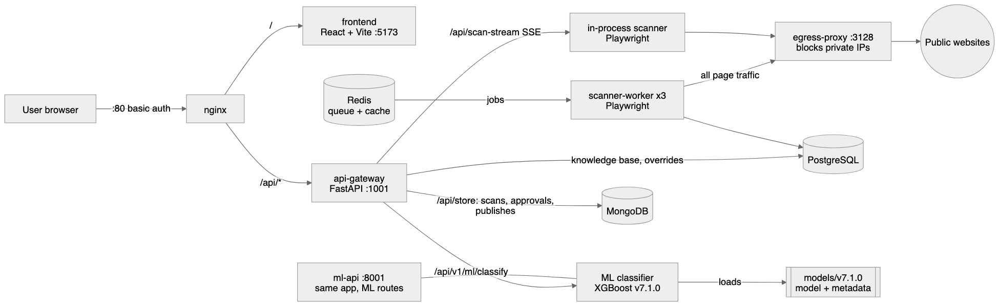
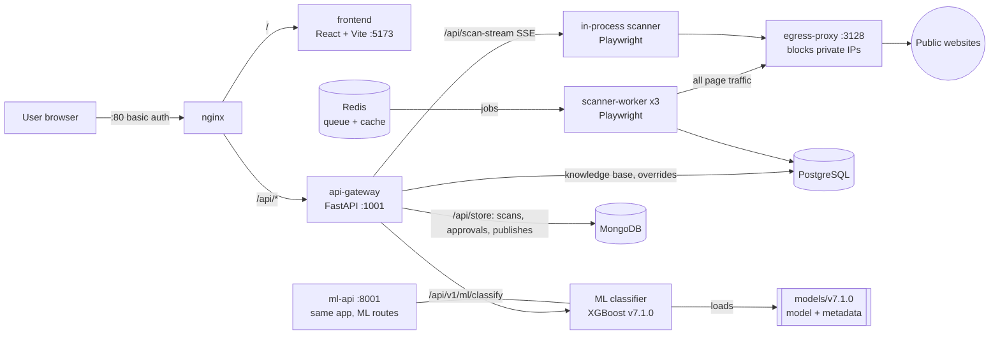
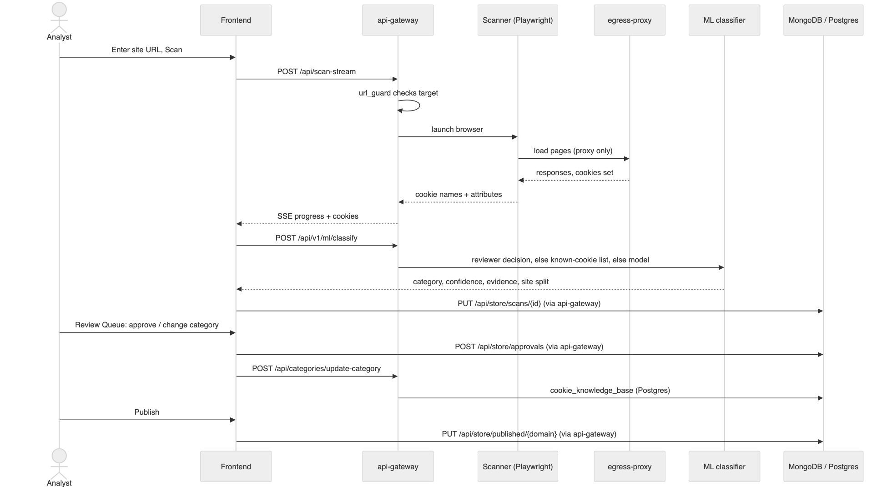
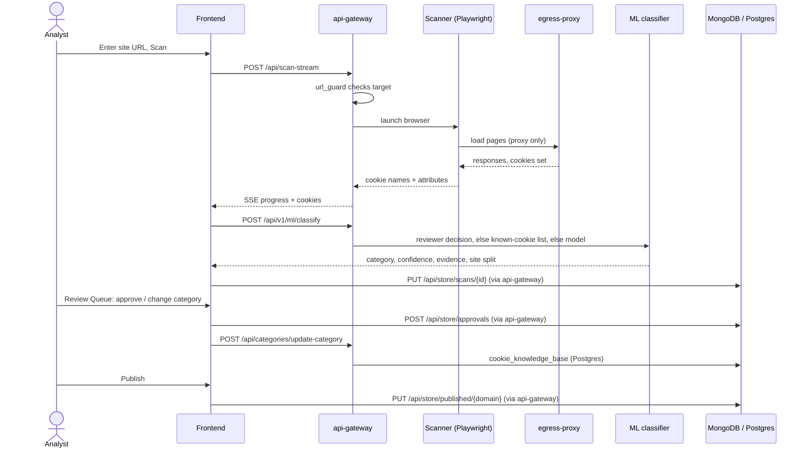
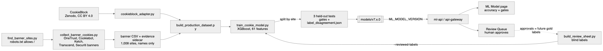
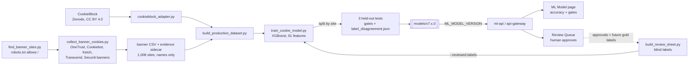

# Architecture

How Cookie Scanner (DataSafeguard) works end to end: what runs, how a scan becomes a
published cookie list, and how the ML model is built. Checked against the code on
2026-11-12 (`docker-compose.yml`, `nginx/nginx.conf`, `backend/`, `src/`).

Diagram sources live in [`diagrams/`](../diagrams/): edit the `.mmd`, or open the
`.excalidraw` at excalidraw.com. The diagrams below are the same sources, inline.

## 1. What runs

| Service | Port | What it does | Code |
|---|---|---|---|
| nginx | 80, 443 | Basic-auth login in front of everything. `/` goes to the frontend, `/api/` to the gateway. `/health` skips auth. | `nginx/nginx.conf` |
| frontend | 127.0.0.1:5173 | React dashboard: Websites, Scan, Scan Results, Cookie Inventory, Review Queue, ML Model, Vendors. Can also run a same-page Quick Scan with no backend. | `src/` |
| api-gateway | 127.0.0.1:1001 | FastAPI app (`backend.main:app`). All routes are under `/api`. | `backend/main.py`, `backend/api/routes.py` |
| ml-api | 127.0.0.1:8001 | The same FastAPI app with `models/` baked in, 4 uvicorn workers. Serves `/api/v1/ml/*` on its own port. | `docker/Dockerfile.ml-api` |
| scanner-worker-1/2/3 | none | Pull scan jobs from Redis and scan with Playwright. See [Known gaps](#known-gaps). | `backend/worker/` |
| egress-proxy | 3128 (internal) | Every scanning browser goes through it. Refuses private, loopback and metadata addresses so a scan target can't reach internal services. | `backend/scanner/egress_proxy.py` |
| PostgreSQL 17 | 127.0.0.1:5432 | `cookie_knowledge_base`, category overrides, ML tables. Hand-written migrations in `backend/db/migrations/`. | `backend/db/` |
| MongoDB 7 | internal | Scan store: scans, approvals, published lists, schedules. | `backend/db/scan_store.py` |
| Redis 7 | 127.0.0.1:6379 | Cache and the worker job queue (`scanner:queue:pending`). | `backend/worker/distributed_scanner.py` |

### API surface (all under `/api`)

| Prefix | Routes | Module |
|---|---|---|
| `/` | `GET /health`, `POST /scan`, `POST /scan-stream` (SSE) | `backend/api/routes.py` |
| `/categories` | `update-category`, `bulk-update-categories`, `category-history/{scan_id}`, `available-categories`, `query-knowledge-base`, `patterns` | `backend/api/category_routes.py` |
| `/v1/ml` | `classify`, `model-info`, `health`, `feedback`, `similar-cookies/{id}`, `metrics`, `drift/check`, `drift/status` | `backend/api/ml_routes.py` |
| `/store` | `scans`, `published`, `schedules`, `approvals`, `import` (GET/PUT/DELETE as fits) | `backend/api/store_routes.py` |

## 2. From scan to published cookie list

1. **Scan.** The frontend calls `POST /api/scan-stream`. `backend/scanner/url_guard.py`
   checks the target first (`check_url`) and installs a request guard on the browser.
   Pages load only through the egress proxy. The scanner records cookie names and
   attributes (domain, expiry, Secure, HttpOnly, SameSite), never cookie values.
   Progress streams back as Server-Sent Events.
2. **Classify.** The frontend sends the cookies to `POST /api/v1/ml/classify`, which
   picks each cookie's category in this order:
   1. a category a reviewer already set (Postgres knowledge base; publishes);
   2. a **known cookie** (`models/known_cookies/known_cookies.json`): at least 3
      websites declare it in their consent banners and two thirds agree, else an
      Open Cookie Database entry (`source: "known_cookie"`, still sent to review);
   3. a name-pattern match from the knowledge base;
   4. the XGBoost model (`backend/api/ml_classifier/classifier.py`, 61 features).

   Each result carries a category, a confidence score, where it came from, and, for
   cookies websites label differently, how the training sites split
   (`site_label_split`, from `label_disagreement.json`). On recent scans about two
   thirds of cookies match a known-cookie list.
3. **Review.** The model is **review-only**: auto-classification is off, so every
   cookie waits in the Review Queue for a person. Approvals go to MongoDB
   (`/api/store/approvals`) and category decisions to the Postgres knowledge base
   (`/api/categories/update-category`).
4. **Publish.** The approved list for a domain is saved with
   `PUT /api/store/published/{domain}`.

Categories: Strictly Necessary, Functional, Analytics & Performance, Marketing &
Advertising, plus Unclassified when nobody has decided yet.

## 3. How the model is built

All scripts are in `backend/scripts/`. Step-by-step commands are in
[`docs/ml-training-runbook.md`](ml-training-runbook.md).

1. **Find sites.** `find_banner_sites.py` keeps only public sites whose robots.txt
   explicitly allows `/` and that show a supported consent banner, one brand per
   parent company.
2. **Collect.** `collect_banner_cookies.py` reads the cookie list each site declares in
   its own consent banner: cookie name, attributes, the site's category, provider and
   description. No logins, no cookie values.
3. **Build the dataset.** `build_production_dataset.py` merges the banner data with
   CookieBlock (via `cookieblock_adapter.py`) and removes duplicates.
4. **Train and test.** `train_cookie_model.py` holds out whole websites so the model is
   tested on sites it never saw. It reports three tests:

   | Test | What it measures | v7.1.0 accuracy |
   |---|---|---|
   | All cookies | Every cookie on the held-out sites (4,410) | 83.0% |
   | Other websites' labels accepted | Same, counting a pick as right when other sites use that label | 94.6% |
   | Never-seen names | Only cookie names absent from training (334); the quality gates use this one | 53.9% |

   It also writes `label_disagreement.json` and an explanation of every gate
   (`acceptance.gates` in `metadata.json`). Filled-in rows from
   `build_review_sheet.py` can be passed with `--reviewed-labels` to score against
   people's labels instead of the websites'.
5. **Deploy.** The package goes to `models/v7.x.0/`; `ML_MODEL_VERSION` in
   `docker-compose.yml` picks it. v7.1.0 is live; roll back with
   `ML_MODEL_VERSION=7.0.0`. Auto-classification stays off until the auto-precision
   gate passes (lower estimate 90.0% today, target 95%).

## Data rules

- Cookie **values** are never stored: the training collector records names and
  attributes only, and the scan store drops values on every save
  (`strip_cookie_values` in `backend/db/scan_store.py`).
- Collection respects robots.txt and site terms and never logs in.
- Every scanning browser goes through the egress proxy; `url_guard` rejects private
  and internal targets before a browser starts.
- The app sits behind nginx basic auth; service ports bind to 127.0.0.1.

## Known gaps

- **Scanner workers get no jobs from the app.** `DistributedScanner.enqueue_scan`
  (`backend/worker/distributed_scanner.py:52`) pushes to `scanner:queue:pending`, but
  nothing in `backend/api/` calls it, and the API doesn't use Redis. Every UI scan runs
  inside the api-gateway through `/api/scan-stream`, so the three worker containers
  wait on an empty queue.
- **Postgres doesn't reconnect.** `backend/db/database.py` tries Postgres 3 times at
  startup, then falls back to JSON files for the life of the process. If the gateway
  starts before Postgres is healthy, restart it: `docker compose restart api-gateway`.
- **Category colours differ.** The ML Classification dropdown uses its own category
  colours; chips elsewhere use the UCM design-system colours.
