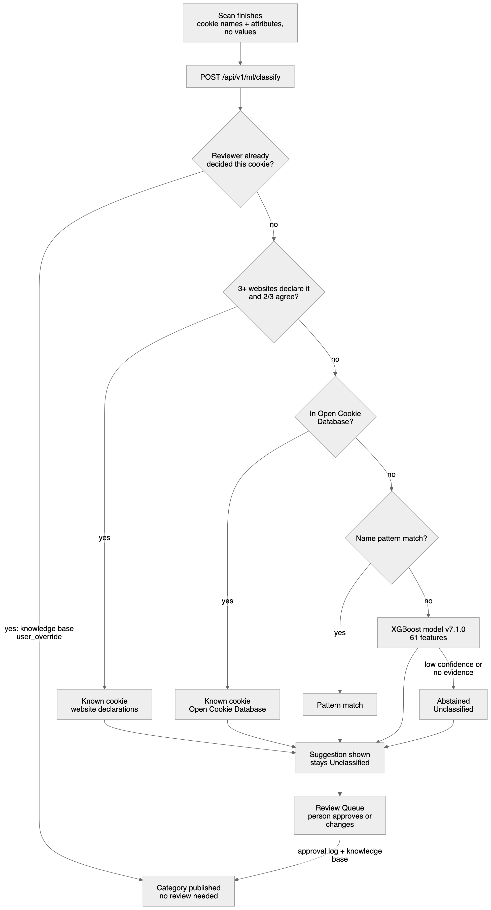
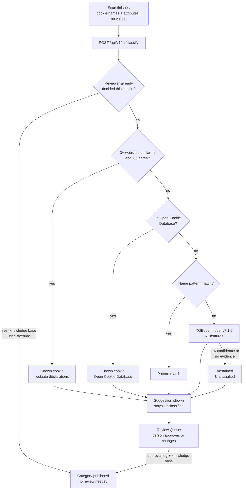
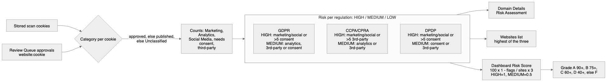
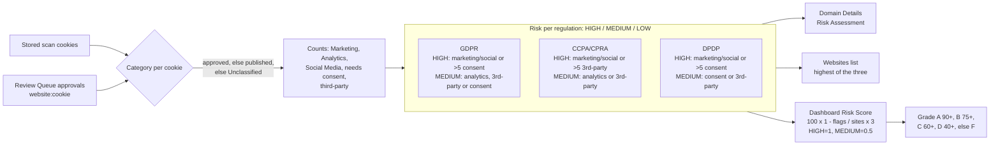

# How cookies get a category and a risk level

What happens to a cookie from the moment a scan finds it until it shows up as a
published category and a GDPR / CCPA / DPDP risk level. For the services and
deployment around this, see [architecture.md](architecture.md).

Diagram sources: [`diagrams/cookie-classification-flow.mmd`](../diagrams/cookie-classification-flow.mmd)
and [`diagrams/risk-assessment-flow.mmd`](../diagrams/risk-assessment-flow.mmd).

## The short version

1. A scan records each cookie's name and attributes. Values are never kept.
2. `/api/v1/ml/classify` suggests a category: a reviewer's earlier decision wins,
   then what other websites declare, then the Open Cookie Database, then a name
   pattern, then the ML model.
3. Only a reviewer's decision publishes. Everything else is a suggestion and the
   cookie stays **Unclassified** until someone approves it in the Review Queue.
4. Risk is worked out from each cookie's **reviewed** category, so it changes as
   reviewers approve cookies.

## 1. How a cookie gets its category

### The checks, in order

The route is `classify_cookies` in `backend/api/ml_routes.py`. For each cookie it
stops at the first check that answers:

| # | Check | Where the answer comes from | `source` | Result |
|---|---|---|---|---|
| 1 | A reviewer already chose this cookie's category | Postgres `cookie_knowledge_base`, via `CategoryManager.get_category_with_fallback` | `user_override` | **Published** (`classification_status: classified`) |
| 2 | At least 3 websites declare the cookie in their consent banners and at least two thirds agree | `models/known_cookies/known_cookies.json` (banner collection + CookieBlock), matched by name family, so `_ga_ABC123` counts as `_ga` | `known_cookie` | Suggestion |
| 3 | The Open Cookie Database lists it: exact name, else the longest wildcard prefix (4+ characters) | same file | `known_cookie` | Suggestion |
| 4 | A stored name pattern matches | knowledge base patterns | `pattern_match` | Suggestion |
| 5 | None of the above | XGBoost model `models/v7.1.0` | `ml_prediction` | Suggestion, or **abstained** |

The model abstains (category Unclassified) when it predicts Unclassified itself
(`model_unclassified`), when the cookie has no name or vendor signal
(`insufficient_evidence`), or when its confidence is under the request's
`confidence_threshold` (`low_confidence`). The threshold only applies to model
predictions.

### What the reviewer sees

Every suggestion keeps where it came from, and the Review Queue shows it:

- **Known cookie** chip with "Declared this way by 41 of 44 websites' consent
  banners" or "Listed in the Open Cookie Database (Stripe)".
- **Sites disagree** chip with the split, for cookies websites label differently
  (`site_label_split`), such as `__stripe_mid`: Strictly Necessary on 8 sites,
  Functional on 7.
- **Needs manual check** when the model had no name or vendor signal.

### Why nothing publishes without a person

Auto-classification is off: v7.1.0 has not passed its auto-precision gate (lower
estimate 90.0%, target 95%). Known-cookie matches are good evidence but not
decisions either. Websites disagree on about 60% of cookies seen on several
sites, and the Open Cookie Database's categories match the website majority 61%
(Strictly Necessary) to 91% (Marketing) of the time.

In the frontend, `publishableCategory` (`src/lib/classificationPolicy.js`) turns
anything that is not `classified` into **Unclassified**, and every Unclassified
cookie counts as needing consent.

### Approving a cookie

In the Review Queue (`src/components/ReviewQueuePage.jsx`):

1. The reviewer keeps the suggestion or picks another category and clicks Approve.
2. `POST /api/categories/update-category` writes it to the knowledge base as a
   reviewer decision. If the database is unavailable it saves to a file fallback
   and the app says "Saved, but not published".
3. Only after that succeeds, the approval is logged in MongoDB
   (`POST /api/store/approvals`, key `<website>:<cookie name>`).

From then on, check 1 answers for that cookie on every future scan, and the
current scan's risk uses the approved category straight away.

### Publishing a website

A website's cookie list is published as a version with
`PUT /api/store/published/{domain}` from Domain Details.

## 2. How risk is worked out

All of this is plain JavaScript in `src/lib/riskCalculator.js`; there is no
weighting or ML.

### Step 1: one category per cookie

`reviewedCategory(cookie, website, approvals)` picks:

1. the Review Queue approval for `<website>:<cookie name>`, if there is one;
2. otherwise the cookie's published category;
3. otherwise **Unclassified**.

Model and known-cookie suggestions are ignored until approved.

### Step 2: counts

`reviewedStatistics` counts, from the cookies themselves:

| Count | Rule |
|---|---|
| By category | Strictly Necessary, Functional, Analytics, Marketing, Social Media, Unclassified |
| Needs consent | every cookie that is not Strictly Necessary, **including Unclassified** |
| Third-party | `isThirdParty`, or `type: "third-party"` |
| Unreviewed | Unclassified cookies |

### Step 3: a level per regulation

| Regulation | HIGH if any | MEDIUM if any | LOW |
|---|---|---|---|
| GDPR | Marketing or Social Media cookie; more than 5 needing consent | Analytics; third-party; any needing consent | only Strictly Necessary |
| CCPA / CPRA | Marketing or Social Media cookie; more than 5 third-party | Analytics; third-party | first-party, no analytics or marketing |
| DPDP | Marketing or Social Media cookie; more than 5 needing consent | any needing consent; third-party | only Strictly Necessary |

The sentence under each level on Domain Details comes from `getRiskExplanation`;
the recommendations from `getRiskRecommendations`.

### Step 4: where it shows

| Screen | What it shows | Code |
|---|---|---|
| Domain Details → Risk Assessment | The three levels with a reason each | `reviewedComplianceRisks` in `DomainDetailsPage.jsx` |
| Websites list | The highest of the three | `websitesFromHistory` in `src/lib/websites.js` |
| Dashboard → Risk Score | `100 × (1 − flags ÷ (websites × 3))`, HIGH = 1 flag, MEDIUM = ½, LOW = 0, over each website's latest scan; grade A 90+, B 75+, C 60+, D 40+, else F | `riskScore` in `src/lib/dashboard.js` |
| Dashboard → high-risk websites | Websites with any regulation HIGH | `dashboardKpis` |
| Dashboard → cookie risk | Unclassified = Critical, anything else = Low | `cookieRisk` |

Scans saved before cookies were stored with them keep the levels saved at scan
time (`scanRisks`).

### Worked example

`shop.com` has 4 cookies, none reviewed yet: `_fbp` (third-party, suggested
Marketing), `_ga` (suggested Analytics), `sessionid` and `lang`.

| Step | Categories used | GDPR | CCPA | DPDP |
|---|---|---|---|---|
| Before review | 4 × Unclassified (4 need consent, 1 third-party) | MEDIUM | MEDIUM | MEDIUM |
| Reviewer approves `_fbp` as Marketing | 1 Marketing, 3 Unclassified | HIGH | HIGH | HIGH |
| Reviewer approves the rest: `_ga` Analytics, `sessionid` Strictly Necessary, `lang` Functional | | HIGH | HIGH | HIGH |
| Site removes `_fbp` and rescans | Analytics, Strictly Necessary, Functional | MEDIUM | MEDIUM | MEDIUM |

With only `shop.com` scanned, the Dashboard score goes from 50 (D) before review
to 0 (F) once `_fbp` is approved, and back to 50 (D) after `_fbp` is removed.

### Limits worth knowing

- The rules are yes/no: one marketing cookie counts the same as fifty.
- The "more than 5" thresholds are fixed numbers with no documented source.
- They don't check whether a consent banner exists, whether cookies are set
  before consent, cookie lifetime, or Secure / SameSite.
- Unreviewed cookies count as needing consent but never as Marketing, so a site
  full of unreviewed advertising cookies shows MEDIUM until someone reviews them.
